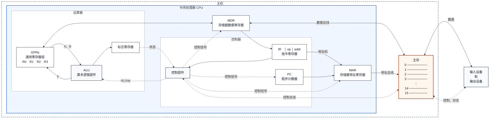
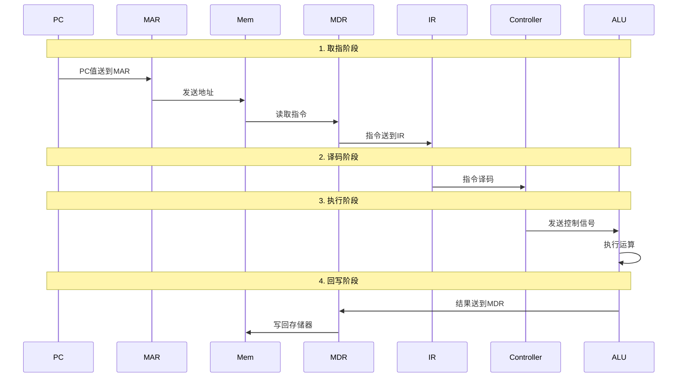

## 1.1.1 冯·诺依曼结构的主要思想

1. 计算机应由**运算器**、**控制器**、**存储器**、**输入设备**和**输出设备**五个基本部件组成。

2. 各基本部件的功能是：

   - **存储器**不仅能存放数据，而且也能存放指令，形式上两者没有区别，但计算机应能区分数据还是指令；

   - **控制器**应能自动取出指令来执行；

   - **运算器**应能进行加/减/乘/除四种基本算术运算，并且也能进行一些逻辑运算和附加运算；

   - 操作人员可以通过**输入设备**、**输出设备**和主机进行通信。

3. 内部以**二进制**表示指令和数据。每条指令由操作码和地址码两部分组成。操作码指出操作类型，地址码指出操作数的地址。由一串指令组成程序。

4. 采用“**存储程序**”工作方式。

## 1.1.2 计算机基本硬件结构

| 缩写 | 英文全称 | 中文名称 | 功能说明 |
|------|----------|----------|----------|
| **CPU** | Central Processing Unit | 中央处理器 | 计算机的核心部件，包含控制器和运算器 |
| **PC** | Program Counter | 程序计数器 | 存放下一条要执行指令的地址 |
| **MAR** | Memory Address Register | 存储器地址寄存器 | 存放要访问的存储单元地址 |
| **MDR** | Memory Data Register | 存储器数据寄存器 | 存放从存储器读出或写入的数据 |
| **IR** | Instruction Register | 指令寄存器 | 存放当前正在执行的指令 |
| **ALU** | Arithmetic Logic Unit | 算术逻辑部件 | 执行算术运算和逻辑运算 |
| **GPRs** | General Purpose Registers | 通用寄存器组 | 存放操作数和中间结果 |

## 1.1.3 指令执行过程

一条指令的执行过程分为以下步骤：

1. **取指**：PC的值送到MAR，从存储器中取出指令送到MDR，再送到IR
2. **译码**：控制器对IR中的指令进行译码，确定操作类型
3. **执行**：根据译码结果，控制器发出控制信号，ALU执行相应运算
4. **回写**：将运算结果写回寄存器或存储器

## 1.1.4 指令

指令就是让 CPU 完成一件事的命令，是 CPU 能够理解并执行的基本单位。

一条指令通常由以下两部分组成：

- **操作码（OP）**：指出 CPU 要执行什么操作，如加、减、读取或存储。
- **地址码（操作数）**：指出参加操作的数据或数据所在的位置。

指令具有**原子性**，即一条指令是 CPU 执行操作时不可再分的基本单位。
