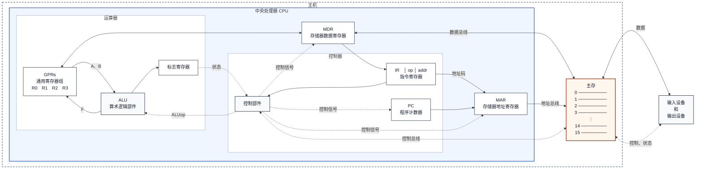
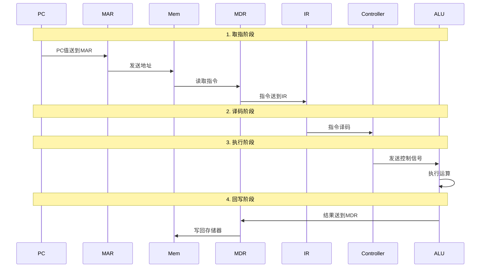
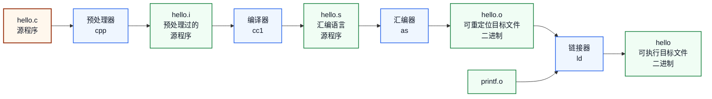
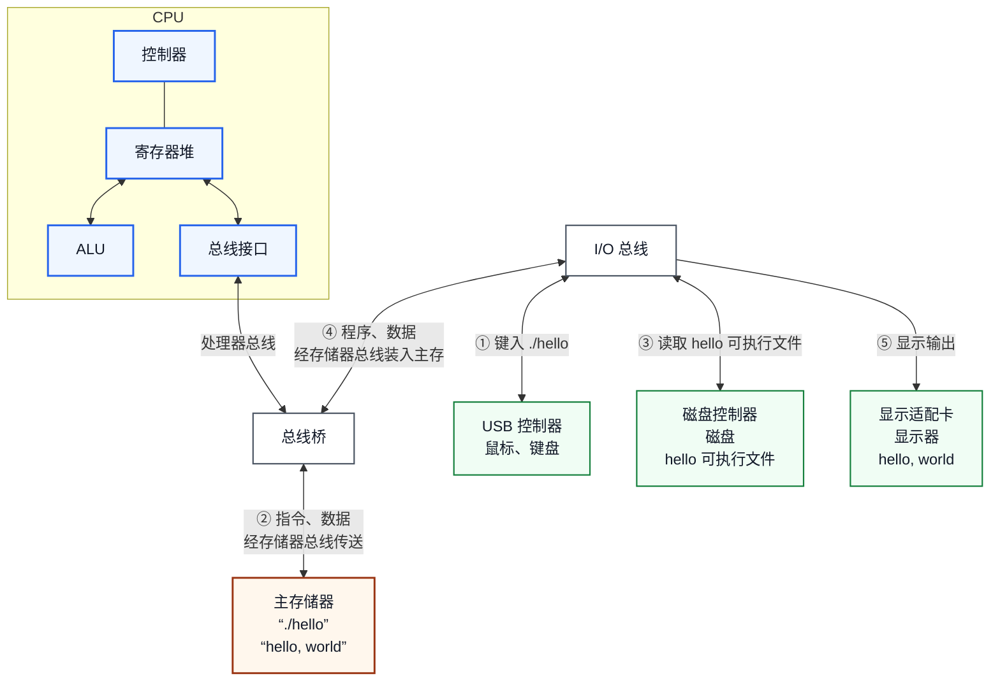

## 1.1.1 冯·诺依曼结构的主要思想

1. 计算机应由**运算器**、**控制器**、**存储器**、**输入设备**和**输出设备**五个基本部件组成。

2. 各基本部件的功能是：

   - **存储器**不仅能存放数据，而且也能存放指令，形式上两者没有区别，但计算机应能区分数据还是指令；

   - **控制器**应能自动取出指令来执行；

   - **运算器**应能进行加/减/乘/除四种基本算术运算，并且也能进行一些逻辑运算和附加运算；

   - 操作人员可以通过**输入设备**、**输出设备**和主机进行通信。

3. 内部以**二进制**表示指令和数据。每条指令由操作码和地址码两部分组成。操作码指出操作类型，地址码指出操作数的地址。由一串指令组成程序。

4. 采用“**存储程序**”工作方式。

## 1.1.2 计算机基本硬件结构

| 缩写 | 英文全称 | 中文名称 | 功能说明 |
|------|----------|----------|----------|
| **CPU** | Central Processing Unit | 中央处理器 | 计算机的核心部件，包含控制器和运算器 |
| **PC** | Program Counter | 程序计数器 | 存放下一条要执行指令的地址 |
| **MAR** | Memory Address Register | 存储器地址寄存器 | 存放要访问的存储单元地址 |
| **MDR** | Memory Data Register | 存储器数据寄存器 | 存放从存储器读出或写入的数据 |
| **IR** | Instruction Register | 指令寄存器 | 存放当前正在执行的指令 |
| **ALU** | Arithmetic Logic Unit | 算术逻辑部件 | 执行算术运算和逻辑运算 |
| **GPRs** | General Purpose Registers | 通用寄存器组 | 存放操作数和中间结果 |

## 1.1.3 指令执行过程

一条指令的执行过程分为以下步骤：

1. **取指**：PC的值送到MAR，从存储器中取出指令送到MDR，再送到IR
2. **译码**：控制器对IR中的指令进行译码，确定操作类型
3. **执行**：根据译码结果，控制器发出控制信号，ALU执行相应运算
4. **回写**：将运算结果写回寄存器或存储器

## 1.1.4 指令

### 1. 指令的基本概念

指令就是让 CPU 完成一件事的命令，是 CPU 能够理解并执行的基本单位。

一条指令通常由以下两部分组成：

- **操作码（OP）**：指出 CPU 要执行什么操作，如加、减、读取或存储。
- **地址码（操作数）**：指出参加操作的数据或数据所在的位置。

指令具有**原子性**，即一条指令是 CPU 执行操作时不可再分的基本单位。

**正确解释和执行指令的两个基本条件：**

CPU 要正确解释并执行一条机器指令，必须知道以下两项规定：

1. **指令格式（Instruction Format）**：规定一条指令由哪些字段组成，以及各字段的位置和位数。CPU 据此判断各段二进制位是操作码、寄存器编号、主存地址还是其他信息。
2. **操作码语义（Opcode Semantics）**：规定每个操作码表示什么操作，以及操作数从哪里取得、运算结果保存到哪里。

指令格式解决的是“**各字段如何划分和解释**”的问题，操作码语义解决的是“**CPU 具体执行什么操作**”的问题。二者都是 CPU 对机器指令进行译码和执行的依据。

更完整地说，这些规定属于**指令集体系结构（Instruction Set Architecture，ISA）**。ISA 是软件与硬件之间的机器级接口，除了指令格式和操作码语义外，通常还规定寄存器、数据类型和寻址方式等内容。

### 2. 指令格式与编码

指令在计算机内部使用二进制表示。下面以一条指令占 **8 位**为例，介绍两种指令格式。

| 指令格式 | 二进制结构 | 各字段含义 | 执行功能 |
|----------|------------|------------|----------|
| R 格式 | `op(4位) + rt(2位) + rs(2位)` | `op` 是操作码，`rt` 是目的寄存器地址，`rs` 是源寄存器地址 | `R[rt] ← R[rs]` 或 `R[rt] ← R[rt] op R[rs]` |
| M 格式 | `op(4位) + addr(4位)` | `op` 是操作码，`addr` 是主存地址 | `R[0] ← M[addr]` 或 `M[addr] ← R[0]` |

其中，**R 格式用于寄存器之间的数据传送和运算，M 格式用于 CPU 与主存之间的数据传送**。

#### （1）R 格式（寄存器型指令）

| 操作码 | 指令 | 功能 |
|--------|------|------|
| `0000` | `mov`（传送） | `R[rt] ← R[rs]` |
| `0001` | `add`（加法） | `R[rt] ← R[rt] + R[rs]` |

- `0000 11 01`：`op=0000`，`rt=11₂=3`，`rs=01₂=1`，执行 `R[3] ← R[1]`。
- `0001 00 01`：`op=0001`，`rt=00₂=0`，`rs=01₂=1`，执行 `R[0] ← R[0] + R[1]`。

#### （2）M 格式（访存型指令）

| 操作码 | 指令 | 功能 |
|--------|------|------|
| `1110` | `load`（取数） | `R[0] ← M[addr]` |
| `1111` | `store`（存数） | `M[addr] ← R[0]` |

- `1110 0110`：`op=1110`，`addr=0110₂=6`，从主存地址 6 取数并送入 `R[0]`。
- `1111 1010`：`op=1111`，`addr=1010₂=10`，将 `R[0]` 中的数据存入主存地址 10。

由此可见，同样是 8 位二进制信息，CPU 会先根据**操作码**判断要执行的操作，再按照相应的**指令格式**解释后面的地址码。

### 3. 指令执行实例：计算 `z = x + y`

计算机完成 `z = x + y` 可以分为两个阶段：

| 阶段 | 名称 | 主要工作 |
|------|------|----------|
| 第一阶段 | **程序装入（Loading）** | 把程序的机器指令和需要处理的数据装入主存，为运行程序做好准备 |
| 第二阶段 | **程序执行（Execution）** | CPU 根据 PC 指出的地址逐条取出指令，经过译码后执行这些指令 |

程序装入只是把指令和数据放到主存中，**装入不等于执行**；程序装入完成后，CPU 才开始执行指令。

假设 `x`、`y` 分别存放在主存的 5、6 号单元，运算结果 `z` 存放在 7 号单元：

| 主存地址 | 主存单元内容 | 内容说明 | 汇编指令 |
|----------|--------------|----------|----------|
| 0 | `1110 0110` | `R[0] ← M[6]`，取出 `y` | `load r0, 6#` |
| 1 | `0000 0100` | `R[1] ← R[0]`，暂存 `y` | `mov r1, r0` |
| 2 | `1110 0101` | `R[0] ← M[5]`，取出 `x` | `load r0, 5#` |
| 3 | `0001 0001` | `R[0] ← R[0] + R[1]` | `add r0, r1` |
| 4 | `1111 0111` | `M[7] ← R[0]`，保存结果 | `store 7#, r0` |
| 5 | `0001 0000` | 操作数 `x=16` | — |
| 6 | `0010 0001` | 操作数 `y=33` | — |
| 7 | `0000 0000` | 结果 `z`，初始值为 0 | — |

主存中的这些内容分为指令和数据两类：

| 主存区域 | 内容类型 | CPU 的使用方式 |
|----------|----------|----------------|
| 地址 0～4 | 指令 | CPU 根据 PC 逐条取出并执行 |
| 地址 5 | 数据 `x=16` | `load` 指令将它读入寄存器 |
| 地址 6 | 数据 `y=33` | `load` 指令将它读入寄存器 |
| 地址 7 | 数据 `z=0` | `store` 指令将运算结果写入这里 |

`x=16`、`y=33` 和 `z=0` 表示变量的数值，不是让 CPU 完成某种操作的命令，因此它们**没有操作码，也不需要采用指令格式**。例如，地址 5 中的 `0001 0000` 作为数据解释时表示十进制数 16。

同一串二进制究竟表示指令还是数据，取决于 CPU 的访问方式：CPU 根据 PC 取出的内容被解释为指令；执行 `load` 或 `store` 时访问的内容或位置被解释为数据。

CPU 按照主存地址从 0 到 4 依次执行指令。每条指令的执行又由取指、译码、PC 增量、执行和送结果等**微操作（Micro-operation）**组成：

| 执行步骤 | `1110 0110` | `0000 0100` | `1110 0101` | `0001 0001` | `1111 0111` |
|----------|-------------|-------------|-------------|-------------|-------------|
| 汇编指令 | `load r0, 6#` | `mov r1, r0` | `load r0, 5#` | `add r0, r1` | `store 7#, r0` |
| 取指令 | `IR ← M[0000]` | `IR ← M[0001]` | `IR ← M[0010]` | `IR ← M[0011]` | `IR ← M[0100]` |
| 译码 | 取数 | 传送 | 取数 | 加法 | 存数 |
| PC 增量 | `PC ← 0000+1` | `PC ← 0001+1` | `PC ← 0010+1` | `PC ← 0011+1` | `PC ← 0100+1` |
| 取数、执行 | `MDR ← M[0110]` | `A ← R[0]`，`F ← A` | `MDR ← M[0101]` | `A ← R[0]`，`B ← R[1]`，`F ← A+B` | `MDR ← R[0]` |
| 送结果 | `R[0] ← MDR` | `R[1] ← F` | `R[0] ← MDR` | `R[0] ← F` | `M[0111] ← MDR` |
| 执行结果 | `R[0]=33` | `R[1]=33` | `R[0]=16` | `R[0]=16+33=49` | `M[7]=49` |

表中的 `A`、`B` 表示 ALU 的两个输入，`F` 表示 ALU 的输出；`IR` 保存当前指令，`PC` 指向下一条指令，`MDR` 临时保存从主存读出或准备写入主存的数据。

表中使用 `IR ← M[PC]` 的形式简写取指过程。结合前面的硬件结构，实际的数据传送过程为 `PC → MAR → 主存 → MDR → IR`。

这个例子说明：一条高级语言语句可能需要多条机器指令共同完成；在冯·诺依曼结构中，**指令和数据都以二进制形式存放在主存中，CPU 按照“取指、译码、执行”的过程逐条执行指令**。

## 1.1.5 程序的编译过程

### 1. 翻译程序的三种类型

把源程序转换成机器可执行的程序的程序统称为**翻译程序**，按翻译方式不同分为三种：

| 类型 | 别称 | 主要特点 | 典型例子 |
|------|------|----------|----------|
| **解释器** | 解释程序 | 读入一句源程序就翻译并执行一句，**不生成目标文件**，边解释边执行 | 解释方式执行的高级语言程序 |
| **编译器** | 编译程序 | 把整个源程序翻译成用汇编语言或机器语言表示的目标程序，生成目标文件 | C 语言编译器 `cc1` |
| **汇编器** | 汇编程序 | 把汇编语言源程序翻译成二进制机器指令（目标代码） | 汇编器 `as` |

### 2. 从源程序到可执行文件

用高级语言编写的源程序（如 `hello.c`）不能直接被 CPU 执行，必须经过一系列转换，变成 **二进制机器指令**。完整的转换依次经过**预处理、编译、汇编、链接**四个阶段，每个阶段都由一个独立的处理程序完成，上一阶段的处理结果就是下一阶段的输入。

| 阶段 | 处理程序 | 处理结果（扩展名） | 主要工作 |
|------|----------|--------------------|----------|
| 预处理阶段 | **预处理器** `cpp` | 源程序 `hello.i`（`.i`） | 展开 `#include` 头文件、替换 `#define` 宏、删除注释，仍是高级语言 |
| 编译阶段 | **编译器** `cc1` | 汇编源程序 `hello.s`（`.s`） | 词法分析、语法分析、语义分析和优化，把高级语言**翻译成汇编语言** |
| 汇编阶段 | **汇编器** `as` | 可重定位目标文件（二进制）`hello.o`（`.o`） | 把汇编指令**翻译成二进制机器指令**（目标代码） |
| 链接阶段 | **链接器** `ld` | 可执行文件（二进制）`hello` | 合并 `hello.o` 和 `printf.o` 等目标文件，分配统一主存地址，**解决符号引用** |

### 3. 编译过程的完整流程

以 GCC 编译 `hello.c` 为例（`printf` 函数定义在单独的目标文件 `printf.o` 中）：

### 4. 两种目标文件的区别

| 类型 | 示例 | 说明 |
|------|------|------|
| **可重定位目标文件** | `hello.o` | 代码和数据尚未确定在主存中的存放地址，不能直接执行，等待链接器重新定位 |
| **可执行目标文件** | `hello` | 链接器完成地址分配和符号解析后生成的完整二进制映像，可以直接装入主存由 CPU 执行 |

`hello.c` 中调用的 `printf` 函数并不在 `hello.o` 里，链接器在链接阶段把 `printf.o` 一并合并进来，才能得到完整的可执行文件 `hello`。因此**汇编阶段结束得到的还只是目标文件，必须经过链接才能执行**。

### 5. 可执行文件的启动和执行

链接生成的可执行文件 `hello` 平时存放在**磁盘**上，运行时要先**装入主存**，再由 CPU 逐条取出指令执行。整个过程由 CPU、主存、磁盘、键盘、显示器等部件在**处理器总线、存储器总线、I/O 总线**的连接下协同完成（对应教材图 1.9）：

说明（对应图中编号）：

1. **① 输入命令**：用户在键盘键入 `./hello`，字符经 USB 控制器、I/O 总线送入主存，shell 读到该命令。
2. **③④ 装入程序**：shell 找到磁盘上的 `hello` 可执行文件，经磁盘控制器、I/O 总线、存储器总线把它**装入主存**。
3. **② 取指执行**：操作系统把 `hello` 第一条指令地址送入 PC，CPU 经处理器总线、存储器总线从主存取指令，按“取指、译码、执行”逐条执行指令。
4. **⑤ 显示输出**：`printf` 要输出的 `hello, world` 从主存经 I/O 总线送显示适配卡，在显示器上显示。

**装入不等于执行**，且执行期间**指令和数据始终存放在主存中**，CPU 通过总线反复访问主存，体现了冯·诺依曼结构的“存储程序”思想。
