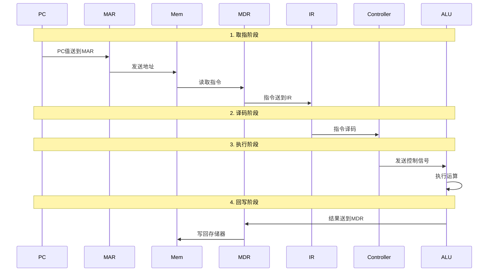

## 1.2.1 指令

### 1. 指令的基本概念

指令就是让 CPU 完成一件事的命令，是 CPU 能够理解并执行的基本单位。

一条指令通常由以下两部分组成：

- **操作码（OP）**：指出 CPU 要执行什么操作，如加、减、读取或存储。
- **地址码（操作数）**：指出参加操作的数据或数据所在的位置。

指令具有**原子性**，即一条指令是 CPU 执行操作时不可再分的基本单位。

### 2. 指令执行过程

一条指令的执行过程分为以下步骤：

1. **取指**：PC的值送到MAR，从存储器中取出指令送到MDR，再送到IR
2. **译码**：控制器对IR中的指令进行译码，确定操作类型
3. **执行**：根据译码结果，控制器发出控制信号，ALU执行相应运算
4. **回写**：将运算结果写回寄存器或存储器

### 3. 指令格式与编码

指令在计算机内部使用二进制表示。下面以一条指令占 **8 位**为例，介绍两种指令格式。

| 指令格式 | 二进制结构 | 各字段含义 | 执行功能 |
|----------|------------|------------|----------|
| R 格式 | `op(4位) + rt(2位) + rs(2位)` | `op` 是操作码，`rt` 是目的寄存器地址，`rs` 是源寄存器地址 | `R[rt] ← R[rs]` 或 `R[rt] ← R[rt] op R[rs]` |
| M 格式 | `op(4位) + addr(4位)` | `op` 是操作码，`addr` 是主存地址 | `R[0] ← M[addr]` 或 `M[addr] ← R[0]` |

其中，**R 格式用于寄存器之间的数据传送和运算，M 格式用于 CPU 与主存之间的数据传送**。

#### （1）R 格式（寄存器型指令）

| 操作码 | 指令 | 功能 |
|--------|------|------|
| `0000` | `mov`（传送） | `R[rt] ← R[rs]` |
| `0001` | `add`（加法） | `R[rt] ← R[rt] + R[rs]` |

- `0000 11 01`：`op=0000`，`rt=11₂=3`，`rs=01₂=1`，执行 `R[3] ← R[1]`。
- `0001 00 01`：`op=0001`，`rt=00₂=0`，`rs=01₂=1`，执行 `R[0] ← R[0] + R[1]`。

#### （2）M 格式（访存型指令）

| 操作码 | 指令 | 功能 |
|--------|------|------|
| `1110` | `load`（取数） | `R[0] ← M[addr]` |
| `1111` | `store`（存数） | `M[addr] ← R[0]` |

- `1110 0110`：`op=1110`，`addr=0110₂=6`，从主存地址 6 取数并送入 `R[0]`。
- `1111 1010`：`op=1111`，`addr=1010₂=10`，将 `R[0]` 中的数据存入主存地址 10。

由此可见，同样是 8 位二进制信息，CPU 会先根据**操作码**判断要执行的操作，再按照相应的**指令格式**解释后面的地址码。

## 1.2.2 程序的编译过程

### 1. 翻译程序的三种类型

把源程序转换成机器可执行的程序的程序统称为**翻译程序**，按翻译方式不同分为三种：

| 类型 | 主要特点 | 典型例子 |
|------|----------|----------|
| **解释器** | 按解释执行的方式，逐行（或逐条语句）翻译并立刻运行，边解释边执行 | 使用 Python 解释器执行 `.py` 脚本；使用 Shell 解释器（如 `bash`）执行 `.sh` 脚本 |
| **编译器** | 先将源程序转换成目标代码，再交给后续工具或运行环境处理 | C 语言程序使用 `gcc` 工具链编译、汇编和链接，生成可执行文件；Java 语言程序使用 `javac` 编译为 `.class` 字节码，再由 JVM 执行 |
| **汇编器** | 把汇编语言翻译成机器码，通常生成可重定位目标文件 | 使用汇编器 `as`，将 `.s` 汇编文件转换为包含机器码的 `.o` 目标文件 |

“逐行（或逐条语句）翻译并立刻运行”用于理解解释执行的基本方式；实际 Python 解释器通常先生成字节码再执行。Shell 脚本常用扩展名是 `.sh`。

**Java 中，`javac` 是编译器，JVM 是执行字节码的虚拟机。** JVM 可以解释执行字节码，也可以通过即时编译（JIT）将热点代码编译为机器码执行。

### 2. 从源程序到可执行文件

| 阶段 | 输入文件 | 处理程序 | 输出文件 | 输出内容 |
|------|----------|----------|----------|----------|
| 预处理 | `hello.c` | 预处理器 `cpp` | `hello.i` | 预处理过的源程序 |
| 编译 | `hello.i` | 编译器 `cc1` | `hello.s` | 汇编语言源程序 |
| 汇编 | `hello.s` | 汇编器 `as` | `hello.o` | 可重定位目标文件（二进制） |
| 链接 | `hello.o`、`printf.o` | 链接器 `ld` | `hello` | 可执行目标文件（二进制） |

**文件后缀怎么记：**

这些后缀大多是约定俗成的缩写，下面是便于记忆的对应方式，不必都理解为官方全称。

| 后缀 | 文件 | 怎么记 |
|------|------|--------|
| `.c` | C 源程序 | **C** 语言本身 |
| `.h` | 头文件 | **header**（头） |
| `.i` | 预处理后的源程序 | **intermediate**（中间的），记作“中间产物” |
| `.s` | 汇编源程序 | 理解为 **assembly** 里的 **s** |
| `.o` | 目标文件 | **object**（目标） |
| 无后缀 / `.out` | 可执行文件 | Linux 下通常无后缀；`a.out` 是 **assembler output** 的历史遗留名称 |

### 3. 可执行文件的启动和执行

