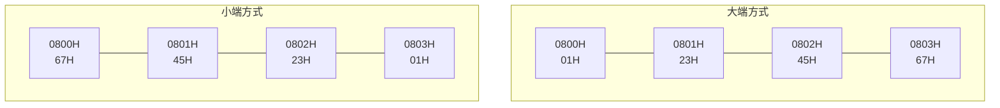

## 2.1.1 进位计数制

### 学习目标

本小节学习二进制、八进制、十进制、十六进制这四种进制及其转换方法。

| 转换方向 | 方法 | 要点 |
|----------|------|------|
| 十进制 → 任意进制 | 除基取余法、乘基取整法 | 整数部分除以目标基数，逆向取余；小数部分乘以目标基数，正向取整 |
| 任意进制 → 十进制 | 按权展开法 | 各位数码乘以对应位权，再求和 |
| 二进制 ↔ 八进制 | 分组转换法 | 每 3 个二进制位对应 1 个八进制位 |
| 二进制 ↔ 十六进制 | 分组转换法 | 每 4 个二进制位对应 1 个十六进制位 |
| 十六进制 ↔ 八进制 | 通过中介进制转换 | 先转换为二进制或十进制，再转换为目标进制 |

分组时以小数点为界：整数部分从右向左分组，小数部分从左向右分组；不足一组时，整数部分在左侧补 0，小数部分在右侧补 0。

### 1. 基数

进位计数制使用有限个数码，按数码所在的位置表示数值。

<span style="color:#c0392b; text-decoration:underline">**基数 R 表示每一位可使用的数码个数，进位规则是“逢 R 进一”。**</span>

- 十进制：基数为 10，数码为 0～9，逢十进一。
- 二进制：基数为 2，数码为 0、1，逢二进一。

### 2. 位权

<span style="color:#c0392b; text-decoration:underline">**位权是某一位置上数码 1 所代表的数值；R 进制中，第 i 位的位权为 R 的 i 次方。**</span>

以小数点为界：

- 小数点左侧，从右向左依次为第 0、1、2、… 位，位权为 $R^0$、$R^1$、$R^2$、…。
- 小数点右侧，从左向右依次为第 −1、−2、−3、… 位，位权为 $R^{-1}$、$R^{-2}$、$R^{-3}$、…。

每一位对整个数值的贡献等于“数码 × 位权”，整个数值等于各位贡献之和。

### 3. 按权展开法

将各位数码乘以对应的位权，再求和，可以把 M 进制数转换为十进制数。

#### （1）十进制

设十进制数为：

$$
D = (d_n d_{n-1}\cdots d_1 d_0.d_{-1}d_{-2}\cdots d_{-m})_{10}
$$

其中 $d_i \in \{0,1,\ldots,9\}$，则：

$$
\begin{aligned}
D &= d_n \times 10^n + d_{n-1} \times 10^{n-1} + \cdots + d_1 \times 10^1 + d_0 \times 10^0 \\
&\quad + d_{-1} \times 10^{-1} + d_{-2} \times 10^{-2} + \cdots + d_{-m} \times 10^{-m}
\end{aligned}
$$

#### （2）二进制

设二进制数为：

$$
B = (b_n b_{n-1}\cdots b_1 b_0.b_{-1}b_{-2}\cdots b_{-m})_2
$$

其中 $b_i \in \{0,1\}$，则：

$$
\begin{aligned}
B &= b_n \times 2^n + b_{n-1} \times 2^{n-1} + \cdots + b_1 \times 2^1 + b_0 \times 2^0 \\
&\quad + b_{-1} \times 2^{-1} + b_{-2} \times 2^{-2} + \cdots + b_{-m} \times 2^{-m}
\end{aligned}
$$

#### （3）示例

十进制数 $(123.45)_{10}$：

$$
(123.45)_{10} = 1 \times 10^2 + 2 \times 10^1 + 3 \times 10^0 + 4 \times 10^{-1} + 5 \times 10^{-2}
$$

二进制数 $(101.01)_2$：

$$
\begin{aligned}
(101.01)_2 &= 1 \times 2^2 + 0 \times 2^1 + 1 \times 2^0 + 0 \times 2^{-1} + 1 \times 2^{-2} \\
&= 4 + 1 + 0.25 = (5.25)_{10}
\end{aligned}
$$

### 4. 十进制转 M 进制

M 表示目标进制的基数。转换时，整数部分和小数部分分别处理，再用小数点连接。

#### （1）整数部分：除基取余法

<span style="color:#c0392b; text-decoration:underline">**反复除以 M，直到商为 0，逆向取余。**</span>

每次用所得的商继续除以 M，记录余数。先得到的是低位，后得到的是高位，因此把余数按从后到前的顺序排列。

例如，将十进制整数 18 转换为二进制：

| 运算 | 商 | 余数 |
|------|----|------|
| 18 ÷ 2 | 9 | 0 |
| 9 ÷ 2 | 4 | 1 |
| 4 ÷ 2 | 2 | 0 |
| 2 ÷ 2 | 1 | 0 |
| 1 ÷ 2 | 0 | 1 |

从下往上读取余数，得到：

$$
(18)_{10} = (10010)_2
$$

#### （2）小数部分：乘基取整法

<span style="color:#c0392b; text-decoration:underline">**反复乘以 M，直到乘积的小数部分为 0，或达到指定精度，正向取整。**</span>

每次记录乘积的整数部分，再用剩余的小数部分继续乘以 M。先得到的是小数点后的第一位，因此把整数部分按获得的先后顺序排列。

例如，将十进制小数 0.625 转换为二进制：

| 运算 | 乘积 | 取出的整数部分 | 剩余小数部分 |
|------|------|----------------|--------------|
| 0.625 × 2 | 1.25 | 1 | 0.25 |
| 0.25 × 2 | 0.5 | 0 | 0.5 |
| 0.5 × 2 | 1.0 | 1 | 0 |

从上往下读取整数部分，得到：

$$
(0.625)_{10} = (0.101)_2
$$

若小数部分不能在有限次运算后变为 0，则按题目要求保留位数，并进行截断或舍入。

#### （3）整数和小数合并

将上述两个结果合并：

$$
(18.625)_{10} = (10010.101)_2
$$

## 2.1.2 定点数的编码规则

### 1. 定点数的编码规则

- 真值、机器数、数符、数值
- 原码表示法（符号-数值表示法）
- 补码表示法（2-补码表示法）
- 反码表示法
- 移码表示法

### 2. 补码表示法

- 正数的补码是自身：$[X_T]_{\text{补}} = X_T = M + X_T \pmod M$
- 负数的补码是模与该数绝对值的差：$[X_T]_{\text{补}} = M - |X_T| = M + X_T \pmod M$
- 0 的补码：$[+0]_{\text{补}} = [-0]_{\text{补}} = 2^n \pm 0 = 10\cdots0 = 00\cdots0 \pmod {2^n}$
- -1 的补码：$[-1]_{\text{补}} = 2^n - 1 = 11\cdots1$（$n$ 个 1）

#### （1）补码的优点

- 0 的表示是唯一的
- 用加法实现减法，加减法统一
- 比原码和反码可以多表示一个最小负数
- 不需要通过循环进位来调整结果

### 3. 几种计算题型

- 已知真值求原码、已知原码求真值（进制转换）
- 已知原码（或真值）求补码（注意补码位数）
- 已知补码求原码（或真值）
- 已知补码求原码相反数的补码

### 4. 例题

#### 1）当补码位数分别为 $n$ 位、$n+1$ 位时，求 $-2^{n-1}$ 的补码

#### 2）设补码位数为 8，求 $110\ 1100$ 和 $-110\ 1100$ 的补码

#### 3）`int x = -1, unsigned int u = 2147483648`

把 x 转成无符号数是多少，把 u 转成有符号数是多少？

#### 4）已知 $[X_T]_{\text{补}} = 1011\ 0100$，求 $[-X_T]_{\text{补}}$

#### 5）已知 $[X_T]_{\text{补}} = 1011\ 0100$，求真值 $X_T$

## 2.1.3 浮点数

### 1. IEEE 754 计数标准

- 16 位半精度：1+5+10
- 32 位单精度：1+8+23
- 64 位双精度：1+11+52

指数决定了范围，尾数决定了精度。

### 2. 浮点数表示的计算步骤

- 分解成符号、指数、尾数三部分
- 符号：0 正、1 负
- 把十进制转成二进制
- 写成科学计数法
- 指数偏移
- 记录尾数
- 写成计算机中的浮点数表示

### 3. 例题

#### 1）把十进制数 -0.75 转成单精度浮点数表示

#### 2）求机器数为 C0A0 0000H 的 IEEE 754 单精度浮点数的值

### 4. 数值类型转换

- 溢出
  - 范围
  - 极大/小值、符号错误、无穷大值
- 舍入
  - 精度
  - 接近真实值但不完全相同

### 5. C语言的数值类型转换

- int、float、double
- int、float → double
- double → float
- double → int
- float → int
- int → float

#### 1）判断下列表达式的真值情况

- `i == (int) (float) i`
- `f == (float) (int) f`
- `i == (int) (double) i`
- `f == (float) (double) f`
- `d == (float) d`
- `f == -(-f)`
- `(d+f) - d == f`

## 2.1.4 数据宽度和单位

### 1. 数据宽度和单位

- 比特
- 字节
- 字
- 字长

### 2. 单位换算

- $1\text{KB} = 1024\text{B} = 2^{10}\text{B}$
- $1\text{MB} = 1024\text{KB} = 2^{20}\text{B}$
- $1\text{GB} = 1024\text{MB} = 2^{30}\text{B}$
- $1\text{TB} = 1024\text{GB} = 2^{40}\text{B}$
- $1\text{PB} = 1024\text{TB} = 2^{50}\text{B}$
- $1\text{EB} = 1024\text{PB} = 2^{60}\text{B}$
- $1\text{ZB} = 1024\text{EB} = 2^{70}\text{B}$

## 2.1.5 大端和小端

### 1. 数据存储和排列顺序

- 最低有效字节（LSB）
- 最高有效字节（MSB）
- 大端
- 小端

`0000 0000 | 0000 0000 | 0000 0000 | 0000 0101`

### 2. 大端方式和小端方式



图 2.5 大端方式和小端方式

## 2.1.6 作业

### 1. 题目

#### 1）把十进制数 25.8125 转换成二进制、八进制、十六进制

#### 2）对整数 4098、-2147483647，分别用 32 位补码整数和 IEEE 754 单精度浮点数表示，结果用十六进制表示

#### 3）下列程序当传入的参数 len 为 0 时，发生了异常，分析原因并修改

```c
float sum_elements(float a[], unsigned len)
{
    int i;
    float result = 0;
    for (i = 0; i <= len-1; i++)
    {
        result += a[i];
    }
}
```

### 2. 图中答案

#### 1）进制转换

$$
(25.8215)_{10} = (11001.1101)_2 = (31.64)_8 = (19.D)_{16}
$$

#### 2）整数和浮点数表示

- 4098
  - 补码：`0000 0000 0000 0000 0001 0000 0000 0010`（`0x1002`）
  - IEEE 754：`0 10001011 00000000001000000000000`（`0x45801000`）
- -2147483647
  - 补码：`1000 0000 0000 0000 0000 0000 0000 0001`（`0x80000001`）
  - IEEE 754：`1 10011110 00000000000000000000000`（`0xCF000000`）

#### 3）程序异常原因及修改

len 为无符号整数，len-1 溢出，i 永远小于 len-1，数组越界；把 len 的类型改为 int 即可。
