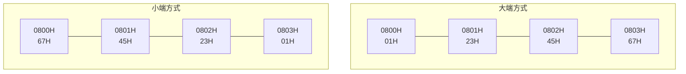

## 2.4.1 数据宽度和单位

### 1. 数据宽度和单位

- 比特
- 字节
- 字
- 字长

### 2. 单位换算

- $1\text{KB} = 1024\text{B} = 2^{10}\text{B}$
- $1\text{MB} = 1024\text{KB} = 2^{20}\text{B}$
- $1\text{GB} = 1024\text{MB} = 2^{30}\text{B}$
- $1\text{TB} = 1024\text{GB} = 2^{40}\text{B}$
- $1\text{PB} = 1024\text{TB} = 2^{50}\text{B}$
- $1\text{EB} = 1024\text{PB} = 2^{60}\text{B}$
- $1\text{ZB} = 1024\text{EB} = 2^{70}\text{B}$
## 2.4.2 大端和小端

### 1. 数据存储和排列顺序

- 最低有效字节（LSB）
- 最高有效字节（MSB）
- 大端
- 小端

`0000 0000 | 0000 0000 | 0000 0000 | 0000 0101`

### 2. 大端方式和小端方式

图 2.5 大端方式和小端方式
