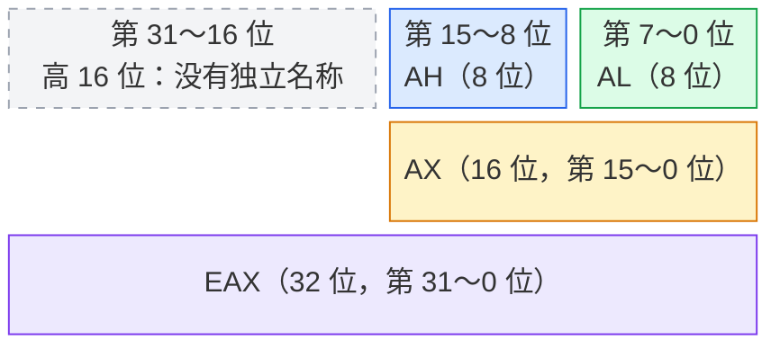

课件来源：《【精讲】萝卜哥自考-计算机系统原理-第3章》，第 8～12 页。

## 3.2.1 IA-32、x86-64

### 1. IA-32

- Intel 8086、80286、i386 等，架构称为 x86。
- 现在 32 位 x86 架构的名称 x86-32 改称为 IA-32。
- 由 16 位架构发展而来，规定一个字为 16 位，32 位是双字。

### 2. x86-64

- AMD 提出了兼容 IA-32 指令集的 64 位架构版本。
- AMD 称为 amd64。
- Intel 称为 Intel64。
- 统称为 x86-64。

## 3.2.2 C语言基本数据类型和 IA-32 操作数类型

### 1. 对应关系

表 3.1 C语言基本数据类型和 IA-32 操作数类型的对应关系

| C语言声明 | Intel 操作数类型 | 汇编指令长度后缀 | 存储长度/位 |
|-----------|------------------|------------------|-------------|
| (unsigned) char | 整数 / 字节 | b | 8 |
| (unsigned) short | 整数 / 字 | w | 16 |
| (unsigned) int | 整数 / 双字 | l | 32 |
| (unsigned) long int | 整数 / 双字 | l | 32 |
| (unsigned) long long int | — | — | 2×32 |
| char * | 整数 / 双字 | l | 32 |
| float | 单精度浮点数 | s | 32 |
| double | 双精度浮点数 | l | 64 |
| long double | 扩展精度浮点数 | t | 80/96 |

## 3.2.3 定点寄存器组

### 1. 8 个通用寄存器

IA-32 中的 8 个通用寄存器均为 **32 位**，名称中的 **E 表示 Extended（扩展）**，表示由原来的 16 位寄存器扩展而来。

| 寄存器 | 英文全称 | 中文名称 | 主要作用 |
|------|------|------|------|
| EAX | Extended Accumulator Register | 扩展累加器 | 存放运算数据和结果；某些乘除法指令隐含使用它；常用于存放函数的整数返回值 |
| EBX | Extended Base Register | 扩展基址寄存器 | 存放数据或地址，可作为基址寄存器参与存储器寻址 |
| ECX | Extended Count Register | 扩展计数寄存器 | 存放计数值；循环和重复串操作常使用它；可变次数的移位、循环移位常用其低 8 位 CL 指定次数 |
| EDX | Extended Data Register | 扩展数据寄存器 | 存放数据；某些乘除法指令将 EDX 与 EAX 配合使用，存放乘积的高位、被除数的高位或余数；端口 I/O 可用其低 16 位 DX 指定端口号 |
| ESP | Extended Stack Pointer | 扩展栈指针寄存器 | 保存栈顶的偏移地址；压栈、出栈、调用和返回等操作会相应更新它 |
| EBP | Extended Base Pointer | 扩展基址指针寄存器 | 常用作当前函数的栈帧基址，通过相对它的偏移访问参数和局部变量 |
| ESI | Extended Source Index | 扩展源变址寄存器 | 存放源操作数的地址；串操作常用作源指针，也可参与一般的变址寻址 |
| EDI | Extended Destination Index | 扩展目的变址寄存器 | 存放目的操作数的地址；串操作常用作目的指针，也可参与一般的变址寻址 |

<span style="color:#c0392b; text-decoration:underline">**记忆：AX 累加、BX 基址、CX 计数、DX 数据；SP 栈顶、BP 栈帧基址、SI 源变址、DI 目的变址。**</span>

表中既有特定指令规定的用途，也有常见的编程约定。例如，用 EAX 存放函数返回值、用 EBP 定位栈帧属于常见约定，具体取决于调用约定和编译器；通用寄存器也可以存放其他数据。

### 2. 2 个专用寄存器

- EIP：指令指针寄存器。
- EFLAGS：标志寄存器。

### 3. 6 个段寄存器

### 4. 分三类看（IA-32）

上述 8 个通用寄存器和 2 个专用寄存器，可以按用途和可访问的位段分为三类：

| 类别 | 寄存器 | 能访问的部分 |
|------|------|------|
| 数据寄存器 | EAX、EBX、ECX、EDX | 32 位、低 16 位、低 16 位中的高 8 位和低 8 位，如 EAX / AX / AH / AL |
| 指针和变址寄存器 | ESP、EBP、ESI、EDI | 32 位、低 16 位（SP、BP、SI、DI），**在 IA-32 中没有独立的 8 位形式** |
| 专用寄存器 | EIP、EFLAGS | 32 位及对应的低 16 位形式（IP、FLAGS），通常不作为普通数据使用，需通过相应指令或机制访问 |

这三类不包含段寄存器。对于数据寄存器，EBX、ECX、EDX 也有类似的名称：BX / BH / BL、CX / CH / CL、DX / DH / DL。

### 5. 用 EAX 理解不同位宽的名称

可以把 EAX 看成一排 **32 个格子**，每个格子存储 1 位二进制数，即 0 或 1。位编号从右到左依次为 0～31：

- 整排 32 格叫 **EAX**，对应第 31～0 位。
- 右边 16 格叫 **AX**，对应第 15～0 位。
- AX 左半边 8 格叫 **AH**，对应第 15～8 位；H 是 High，表示高。
- AX 右半边 8 格叫 **AL**，对应第 7～0 位；L 是 Low，表示低。
- EAX 的高 16 位（第 31～16 位）没有像 AX 这样的独立寄存器名称。



<span style="color:#c0392b; text-decoration:underline">**EAX、AX、AH、AL 是同一个寄存器不同位段的名称，共享存储空间，不是四个独立的寄存器。**</span>

例如，若 EAX 中的值为 `0x12345678`，则 AX 为 `0x5678`，AH 为 `0x56`，AL 为 `0x78`。若仅将 AL 改为 `0xAB`，EAX 就变成 `0x123456AB`，其他位保持不变。

### 6. 寄存器名称与位数的记忆规律

**需要记住常用寄存器的名称和对应位数**，读汇编指令时才能判断操作数大小。做题时应能根据名称自行判断，不依赖题目额外标注位数。

下面的规律适用于 **IA-32 的通用寄存器**：

| 名称规律 | 位数 | 寄存器名称 |
|------|:------:|------|
| E 开头 | 32 位 | EAX、EBX、ECX、EDX、ESP、EBP、ESI、EDI |
| 去掉 E | 16 位 | AX、BX、CX、DX、SP、BP、SI、DI |
| A/B/C/D 后接 H 或 L | 8 位 | AH、AL、BH、BL、CH、CL、DH、DL |

先记住 **EAX → AX → AH / AL** 这一组，EBX、ECX、EDX 按相同规律理解。ESP、EBP、ESI、EDI 在 IA-32 中没有独立的 8 位形式。

AT&T 格式用指令后缀表示操作数大小：

| 位数 | 后缀 | 含义 |
|------|:------:|------|
| 8 位 | `b` | Byte，字节 |
| 16 位 | `w` | Word，字 |
| 32 位 | `l` | Long，双字 |

<span style="color:#c0392b; text-decoration:underline">**先看寄存器名称确定操作数位数，再选择指令后缀；扩展传送的两个后缀依次表示源、目的操作数的大小。**</span>

例如：

```asm
movl   %eax, %ebx   # 两边都是 32 位，普通传送用 l
movsbl %al, %edx    # AL 为 8 位，EDX 为 32 位，符号扩展用 bl
movswl %ax, %edx    # AX 为 16 位，EDX 为 32 位，符号扩展用 wl
movzbl %al, %edx    # 同样是 8 位扩展至 32 位，改为零扩展
```

如果操作数在内存中，地址本身不能说明数据大小，应根据变量类型、题目条件或指令后缀判断。例如，`movsbl (%edx), %eax` 从 EDX 指向的内存读取 **8 位数据**，再符号扩展为 32 位；EDX 本身为 32 位，并不意味着它指向的数据也是 32 位。

## 3.2.4 标志

### 1. 条件标志

| 标志 | 含义 |
|------|------|
| OF | 溢出标志 |
| SF | 符号标志 |
| ZF | 零标志 |
| CF | 进位标志 |

### 2. 控制标志

| 标志 | 含义 |
|------|------|
| DF | 方向标志 |
| IF | 中断允许标志 |
| TF | 陷阱标志 |

## 3.2.5 IA-32 寻址方式、指令的操作数类型

### 1. 什么是寻址

<span style="color:#c0392b; text-decoration:underline">**根据指令给定信息得到操作数或其地址。**</span>

### 2. 寻址方式与操作数类型

- 立即寻址：操作数在指令中（立即数）。
- 寄存器寻址：操作数在寄存器中（寄存器操作数）。
- 其他寻址：操作数在存储器中（存储器操作数）。
  - 实地址模式
  - 保护模式
