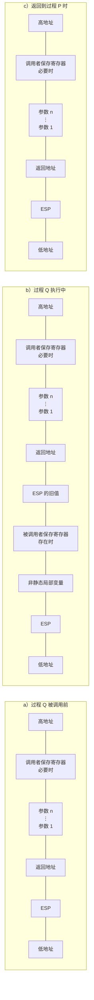
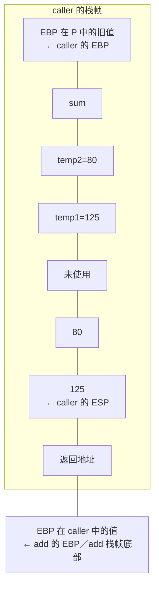

课件来源：《【精讲】萝卜哥自考-计算机系统原理-第3章》，第 24～35 页。

## 3.4.1 C语言程序的机器级表示

### 1. 内容

- 过程调用
- 选择语句
- 循环语句

## 3.4.2 过程调用

### 1. 过程调用（P 调用 Q）

1. P 将实参放到 Q 能取到的地方。
2. P 将返回地址压栈，然后把控制转移到 Q。
3. Q 保存 P 的现场，给自己的内部非静态局部变量分配空间。
4. 执行 Q 的函数体。
5. Q 恢复 P 的现场，释放局部变量所占空间。
6. Q 取出返回地址，把控制转移到 P。

### 2. 过程调用过程中栈和栈帧的变化



图 3.8 过程调用过程中栈和栈帧的变化

### 3. 例题

#### 1）caller 调用 add

C语言代码：

```c
int add(int x, int y) {
    return x + y;
}

int caller() {
    int temp1 = 125;
    int temp2 = 80;
    int sum = add(temp1, temp2);
    return sum;
}
```

caller 的汇编代码：

```asm
caller:
    pushl %ebp
    movl  %esp, %ebp
    subl  $24, %esp
    movl  $125, -12(%ebp)   # M[R[ebp]-12] ← 125，即 temp1=125
    movl  $80, -8(%ebp)     # M[R[ebp]-8] ← 80，即 temp2=80
    movl  -8(%ebp), %eax    # R[eax] ← M[R[ebp]-8]，即 R[eax]=temp2
    movl  %eax, 4(%esp)     # M[R[esp]+4] ← R[eax]，即 temp2 入栈
    movl  -12(%ebp), %eax   # R[eax] ← M[R[ebp]-12]，即 R[eax]=temp1
    movl  %eax, (%esp)      # M[R[esp]] ← R[eax]，即 temp1 入栈
    call  add              # 调用 add，将返回值保存在 EAX 中
    movl  %eax, -4(%ebp)    # M[R[ebp]-4] ← R[eax]，即 add 返回值送 sum
    movl  -4(%ebp), %eax    # R[eax] ← M[R[ebp]-4]，即 sum 作为 caller 返回值
    leave
    ret
```

caller 和 add 的栈帧：



图 3.9 caller 和 add 的栈帧

## 3.4.3 按值传参、按地址传参

### 1. 传参方式

- 按值传参：基本数据类型（整形、浮点型、字符型）。
- 按地址传参：数组、结构体、指针。

### 2. 程序示例

#### 1）程序一

```c
#include <stdio.h>
main() {
    int a = 15, b = 22;
    printf("a=%d\tb=%d\n", a, b);
    swap(&a, &b);
    printf("a=%d\tb=%d\n", a, b);
}
swap(int *x, int *y) {
    int t = *x;
    *x = *y;
    *y = t;
}
```

#### 2）程序二

```c
#include <stdio.h>
main() {
    int a = 15, b = 22;
    printf("a=%d\tb=%d\n", a, b);
    swap(a, b);
    printf("a=%d\tb=%d\n", a, b);
}
swap(int x, int y) {
    int t = x;
    x = y;
    y = t;
}
```

图 3.11 按值传递参数和按地址传递参数的程序示例

### 3. 传递 swap 过程参数的汇编代码片段

#### （1）程序一汇编代码片段

```asm
main:
    # ...
    leal -8(%ebp), %eax
    movl %eax, 4(%esp)
    leal -4(%ebp), %eax
    movl %eax, (%esp)
    call swap
    # ...
    ret
```

#### （2）程序二汇编代码片段

```asm
main:
    # ...
    movl -8(%ebp), %eax
    movl %eax, 4(%esp)
    movl -4(%ebp), %eax
    movl %eax, (%esp)
    call swap
    # ...
    ret
```

图 3.13 两个程序中传递 swap 过程参数的汇编代码片段

## 3.4.4 选择语句

### 1. 例题

#### 1）写出函数体对应的汇编代码（AT&T 格式）

已知形参 p1、p2 对应的实参已压入栈，p1、p2 对应的实参地址为 `R[ebp]+8`、`R[ebp]+12`。这里 EBP 指向栈帧底部，返回结果存放在 EAX 中，写出函数体对应的汇编代码（AT&T 格式）。

```c
int get_lowaddr_content(int *p1, int *p2) {
    if (p1 > p2)
        return *p2;
    else
        return *p1;
}
```

课件给出的汇编代码：

```asm
    movl 8(%ebp), %eax    # R[eax] ← M[R[ebp]+8]，即 R[eax]=p1
    movl 12(%ebp), %edx   # R[edx] ← M[R[ebp]+12]，即 R[edx]=p2
    cmpl %edx, %eax       # 比较 p1 和 p2，根据 p1-p2 的结果置标志
    jbe  .L1             # 若 p1<=p2，则转 L1 处执行
    movl (%edx), %eax     # R[eax] ← M[R[edx]]，即 R[eax]=M[p2]
    jmp  .L2             # 无条件跳转到 L2 执行
.L1:
    movl (%eax), %eax     # R[eax] ← M[R[eax]]，即 R[eax]=M[p1]
.L2:
```

## 3.4.5 循环语句

### 1. for 语句及对应形式

```c
for (begin_expr; cond_expr; update_expr)
    loop_body_statement
```

对应形式：

```c
begin_expr;
c = cond_expr;
if (!c) goto done;
loop: loop_body_statement
update_expr;
c = cond_expr;
if (c) goto loop;
done:
```

### 2. 例题

#### 1）根据汇编代码补全 C语言代码

汇编代码：

```asm
    movl 8(%ebp), %ebx
    movl $0, %eax
    movl $0, %ecx
.L12:
    leal (%eax,%eax), %edx
    movl %ebx, %eax
    andl $1, %eax
    orl  %edx, %eax
    shrl %ebx
    addl $1, %ecx
    cmpl $32, %ecx
    jne  .L12
```

待补全的 C语言代码：

```c
int func_test(unsigned x) {
    int result = 0;
    int i;
    for ( /* ① */ ; /* ② */ ; /* ③ */ ) {
        /* ④ */
    }
    return result;
}
```
