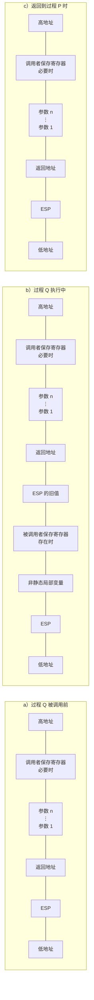

课件来源：《【精讲】萝卜哥自考-计算机系统原理-第3章》，第 24～35 页。

## 3.4.1 C语言程序的机器级表示

### 1. 内容

- 过程调用
- 选择语句
- 循环语句

## 3.4.2 过程调用

### 1. 过程调用（P 调用 Q）

1. P 将实参放到 Q 能取到的地方。
2. P 将返回地址压栈，然后把控制转移到 Q。
3. Q 保存 P 的现场，给自己的内部非静态局部变量分配空间。
4. 执行 Q 的函数体。
5. Q 恢复 P 的现场，释放局部变量所占空间。
6. Q 取出返回地址，把控制转移到 P。

### 2. 过程调用过程中栈和栈帧的变化



图 3.8 过程调用过程中栈和栈帧的变化

#### （1）旧 EBP、返回地址和参数的栈布局

下面以 IA-32 中按从右到左的顺序通过栈传递参数为例：参数依次为 `d`、`x`、`y`，其中 `d` 是 32 位指针，`x` 占 32 位，`y` 占 64 位。执行函数开头的 `pushl %ebp` 和 `movl %esp, %ebp` 后，栈布局如下：


此时 `0(%ebp)` 保存旧 EBP，`4(%ebp)` 保存返回地址，第一个参数从 `8(%ebp)` 开始。图中 ESP 与 EBP 重合的时刻是在上述两条指令刚执行完、尚未继续分配局部变量空间时。

## 3.4.3 按值传参、按地址传参

### 1. 传参方式

- 按值传参：基本数据类型（整形、浮点型、字符型）。
- 按地址传参：数组、结构体、指针。

### 2. 程序示例

#### 1）程序一

```c
#include <stdio.h>
main() {
    int a = 15, b = 22;
    printf("a=%d\tb=%d\n", a, b);
    swap(&a, &b);
    printf("a=%d\tb=%d\n", a, b);
}
swap(int *x, int *y) {
    int t = *x;
    *x = *y;
    *y = t;
}
```

#### 2）程序二

```c
#include <stdio.h>
main() {
    int a = 15, b = 22;
    printf("a=%d\tb=%d\n", a, b);
    swap(a, b);
    printf("a=%d\tb=%d\n", a, b);
}
swap(int x, int y) {
    int t = x;
    x = y;
    y = t;
}
```

图 3.11 按值传递参数和按地址传递参数的程序示例

### 3. 传递 swap 过程参数的汇编代码片段

#### （1）程序一汇编代码片段

```asm
main:
    # ...
    leal -8(%ebp), %eax
    movl %eax, 4(%esp)
    leal -4(%ebp), %eax
    movl %eax, (%esp)
    call swap
    # ...
    ret
```

#### （2）程序二汇编代码片段

```asm
main:
    # ...
    movl -8(%ebp), %eax
    movl %eax, 4(%esp)
    movl -4(%ebp), %eax
    movl %eax, (%esp)
    call swap
    # ...
    ret
```

图 3.13 两个程序中传递 swap 过程参数的汇编代码片段

## 3.4.4 选择语句

选择语句先比较条件、设置标志位，再通过条件跳转选择执行分支；各分支完成后汇合到后续代码。

## 3.4.5 循环语句

### 1. for 语句及对应形式

```c
for (begin_expr; cond_expr; update_expr)
    loop_body_statement
```

对应形式：

```c
begin_expr;
c = cond_expr;
if (!c) goto done;
loop: loop_body_statement
update_expr;
c = cond_expr;
if (c) goto loop;
done:
```
