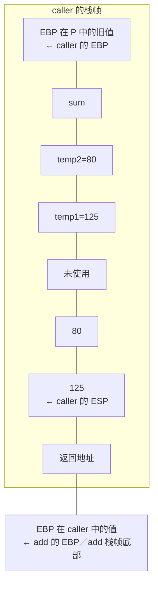

课件来源：《【精讲】萝卜哥自考-计算机系统原理-第3章》，第 13～39 页。原有课后作业保留题目，课堂例题按知识点集中在本页。

## 3.6.1 程序转换与汇编指令作业

### 1. 作业题目

#### 1）名词解释：基址寄存器、栈指针寄存器、立即寻址

#### 2）高级语言转换成机器代码需要经历哪些步骤？

#### 3）Intel 和 AT&T 指令格式有哪些区别？

#### 4）写出下列指令的功能，根据操作数的长度确定指令长度后缀

```asm
mov  8(%ebp, %ebx, 4), %ax
mov  %al, 12(%ebp)
add  (, %ebx, 4), %ebx
push $0xF8
mov  $0xFFF0, %eax
lea  8(%ebx, %esi), %eax
```

## 3.6.2 过程调用与执行流控制作业

### 1. 作业题目

#### 1）名词解释：CISC/RISC、调用者保存寄存器、栈帧、按地址传参

#### 2）按值传参和按地址传参有什么区别？

#### 3）无条件跳转指令和条件跳转指令有什么相同点和不同点？

#### 4）找出下列 AT&T 格式代码的错误

```asm
movl 0xFF, (%eax)
movb %ax, 12(%ebp)
addl %ecx, $0xF0
andl %esi, %esx
movw 8(%ebp, , 4), %ax
```

## 3.6.3 综合作业

### 1. 作业题目

#### 1）写出赋值语句的机器级代码（原题 5）

假设变量 x 和 ptr 的类型声明如下：

```c
src_type x;
dst_type *ptr;
```

这里，src_type 和 dst_type 是用 typedef 声明的数据类型。有以下一个 C语言赋值语句：

```c
*ptr = (dst_type) x;
```

若 x 存储在寄存器 EAX 或 AX 或 AL 中，ptr 存储在寄存器 EDX 中，则对于表 3.12 中给出的 src_type 和 dst_type 的类型组合，写出实现上述赋值语句的机器级代码。要求用 AT&T 格式表示机器级代码。

表 3.12 题 5 用表

| src_type | dst_type | 机器级表示 |
|----------|----------|------------|
| char | int | |
| int | char | |
| int | unsigned | |
| short | int | |
| unsigned char | unsigned | |
| char | unsigned | |
| int | int | |

#### 2）注释 product 的汇编指令并判断数据类型（原题 10）

假设函数 product 的 C语言代码如下，其中 num_type 是用 typedef 声明的数据类型。

```c
void product(num_type *d, unsigned x, num_type y) {
    *d = x * y;
}
```

函数 product 的过程体对应的主要汇编代码如下：

```asm
movl  12(%ebp), %eax
movl  20(%ebp), %ecx
imull %eax, %ecx
mull  16(%ebp)
leal  (%ecx, %edx), %edx
movl  8(%ebp), %ecx
movl  %eax, (%ecx)
movl  %edx, 4(%ecx)
```

请给出上述每条汇编指令的注释，并说明 num_type 是什么类型。

#### 3）分析 lproc 并补全 C代码（原题 18）

函数 lproc 的过程体对应的汇编代码如下：

```asm
    movl  8(%ebp), %edx
    movl  12(%ebp), %ecx
    movl  $255, %esi
    movl  $-2147483648, %edi
.L3:
    movl  %edi, %eax
    andl  %edx, %eax
    xorl  %eax, %esi
    movl  %ecx, %ebx
    shrl  %bl, %edi
    testl %edi, %edi
    jne   .L3
    movl  %esi, %eax
```

上述代码根据以下 lproc 函数的 C代码编译生成：

```c
int lproc(int x, int k) {
    int val = ______;
    int i;
    for (i = ______; i ______; i = ______) {
        val ^= ______;
    }
    return val;
}
```

回答下列问题或完成下列任务：

1. 给每条汇编指令添加注释。
2. 参数 x 和 k 分别存放在哪个寄存器中？局部变量 val 和 i 分别存放在哪个寄存器中？
3. 局部变量 val 和 i 的初始值分别是什么？
4. 循环终止条件是什么？循环控制变量 i 是如何被修改的？
5. 填写 C代码中缺失的部分。

## 3.6.4 常用指令例题

### 例题1：将以下 Intel 格式指令转换为 AT&T 格式指令，并说明功能

```asm
push ebp
mov  ebp, esp
mov  edx, DWORD PTR [ebp+8]
mov  bl, 255
mov  ax, WORD PTR [ebp+edx*4+8]
mov  WORD PTR [ebp+20], dx
lea  eax, [ecx+edx*4+8]
```

<details class="example-answer">
<summary>答案</summary>

```asm
pushl %ebp                     # 保存旧 EBP
movl  %esp, %ebp               # 建立栈帧基址
movl  8(%ebp), %edx            # 从内存取 32 位数据
movb  $255, %bl                # BL = 0xFF
movw  8(%ebp,%edx,4), %ax      # 从有效地址取 16 位数据
movw  %dx, 20(%ebp)            # 向内存写入 16 位数据
leal  8(%ecx,%edx,4), %eax     # EAX = ECX + 4*EDX + 8，不读取该地址的内容
```

Intel 写目的操作数在前；AT&T 写源操作数在前，并使用 `%` 标记寄存器、`$` 标记立即数，用后缀指定数据大小。

</details>

### 例题2：执行加法指令后的寄存器内容和标志位

假设 `R[ax]=FFFAH`，`R[bx]=FFF0H`，则执行 Intel 格式的指令 `add ax, bx` 之后，AX 和 BX 中的内容是什么？标志位是什么？分别将操作数作为无符号整数和带符号整数来解释。

<details class="example-answer">
<summary>答案</summary>

`0xFFFA + 0xFFF0 = 0x1FFEA`，保留低 16 位，AX 为 `FFEAH`，BX 不变，仍为 `FFF0H`。

- 无符号解释：65530 + 65520 = 131050，超出 16 位无符号范围，CF=1。
- 有符号解释：−6 + (−16) = −22，未溢出，OF=0。
- 结果非零且最高位为 1，因此 ZF=0、SF=1；低字节 EA 有奇数个 1，因此 PF=0；低半字节相加无进位，因此 AF=0。

</details>

### 例题3：判断 x 和 y 在 C语言中的数据类型，并说明指令功能

以下两组指令序列将 x 和 y 的比较结果记录到 CL 寄存器，分别判断 x 和 y 在 C语言中的数据类型，并说明指令功能。

第一组：

```asm
cmpl %eax, %edx    # R[eax]=x, R[edx]=y
setb %cl
```

第二组：

```asm
cmpw %ax, %dx     # R[ax]=x, R[dx]=y
setl %cl
```

<details class="example-answer">
<summary>答案</summary>

第一组使用 32 位比较与无符号条件 `setb`，通常对应 `unsigned int x, y`。`cmpl %eax, %edx` 比较 `y-x`，CL 为 `(y < x)` 的结果（0 或 1）。

第二组使用 16 位比较与有符号条件 `setl`，通常对应 `short x, y`。`cmpw %ax, %dx` 比较 `y-x`，CL 同样为 `(y < x)` 的结果，但按有符号数比较。具体 typedef 名称不能仅凭指令确定。

</details>

## 3.6.5 过程调用例题

### 例题4：caller 调用 add

C语言代码：

```c
int add(int x, int y) {
    return x + y;
}

int caller() {
    int temp1 = 125;
    int temp2 = 80;
    int sum = add(temp1, temp2);
    return sum;
}
```

请说明 caller 如何传递参数、取得返回值，并画出 caller 和 add 的栈帧。

<details class="example-answer">
<summary>答案</summary>

caller 的汇编代码：

```asm
caller:
    pushl %ebp
    movl  %esp, %ebp
    subl  $24, %esp
    movl  $125, -12(%ebp)   # M[R[ebp]-12] ← 125，即 temp1=125
    movl  $80, -8(%ebp)     # M[R[ebp]-8] ← 80，即 temp2=80
    movl  -8(%ebp), %eax    # R[eax] ← M[R[ebp]-8]，即 R[eax]=temp2
    movl  %eax, 4(%esp)     # M[R[esp]+4] ← R[eax]，即 temp2 入栈
    movl  -12(%ebp), %eax   # R[eax] ← M[R[ebp]-12]，即 R[eax]=temp1
    movl  %eax, (%esp)      # M[R[esp]] ← R[eax]，即 temp1 入栈
    call  add              # 调用 add，将返回值保存在 EAX 中
    movl  %eax, -4(%ebp)    # M[R[ebp]-4] ← R[eax]，即 add 返回值送 sum
    movl  -4(%ebp), %eax    # R[eax] ← M[R[ebp]-4]，即 sum 作为 caller 返回值
    leave
    ret
```

caller 和 add 的栈帧：



图 3.9 caller 和 add 的栈帧

`temp1=125`、`temp2=80`，返回值为 205，由 EAX 传回。

</details>

## 3.6.6 选择与循环例题

### 例题5：写出函数体对应的汇编代码（AT&T 格式）

已知形参 p1、p2 对应的实参已压入栈，p1、p2 对应的实参地址为 `R[ebp]+8`、`R[ebp]+12`。这里 EBP 指向栈帧底部，返回结果存放在 EAX 中，写出函数体对应的汇编代码（AT&T 格式）。

```c
int get_lowaddr_content(int *p1, int *p2) {
    if (p1 > p2)
        return *p2;
    else
        return *p1;
}
```

<details class="example-answer">
<summary>答案</summary>

课件给出的汇编代码：

```asm
    movl 8(%ebp), %eax    # R[eax] ← M[R[ebp]+8]，即 R[eax]=p1
    movl 12(%ebp), %edx   # R[edx] ← M[R[ebp]+12]，即 R[edx]=p2
    cmpl %edx, %eax       # 比较 p1 和 p2，根据 p1-p2 的结果置标志
    jbe  .L1             # 若 p1<=p2，则转 L1 处执行
    movl (%edx), %eax     # R[eax] ← M[R[edx]]，即 R[eax]=M[p2]
    jmp  .L2             # 无条件跳转到 L2 执行
.L1:
    movl (%eax), %eax     # R[eax] ← M[R[eax]]，即 R[eax]=M[p1]
.L2:
```

</details>

### 例题6：根据汇编代码补全 C语言代码

汇编代码：

```asm
    movl 8(%ebp), %ebx
    movl $0, %eax
    movl $0, %ecx
.L12:
    leal (%eax,%eax), %edx
    movl %ebx, %eax
    andl $1, %eax
    orl  %edx, %eax
    shrl %ebx
    addl $1, %ecx
    cmpl $32, %ecx
    jne  .L12
```

待补全的 C语言代码：

```c
int func_test(unsigned x) {
    int result = 0;
    int i;
    for ( /* ① */ ; /* ② */ ; /* ③ */ ) {
        /* ④ */
    }
    return result;
}
```

<details class="example-answer">
<summary>答案</summary>

① `i = 0`；② `i < 32`；③ `i++`；④ `result = (result << 1) | (x & 1); x >>= 1;`。

每轮将 x 的最低位拼到结果末尾，再将 x 逻辑右移一位，共循环 32 次，得到 x 的 32 位位序反转结果。为使 C 实现的移位行为明确，结果变量建议声明为 `unsigned result = 0`；题目中的有符号 `int result` 左移可能超出可表示范围，不能对任意输入都作为可移植 C 代码使用。

</details>
