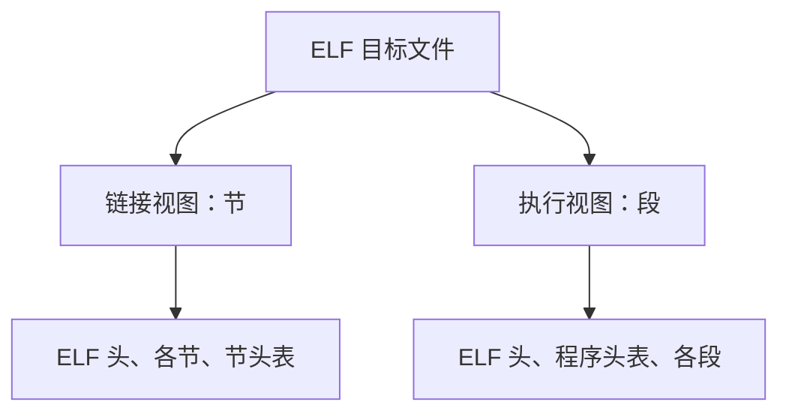

课件来源：《【精讲】萝卜哥自考-计算机系统原理-第4章》，第 1～7 页。

## 4.1.1 可执行文件的生成过程

### 1. 可执行文件的生成过程

**预处理（C 预处理器是 cpp）：**

```bash
gcc -E hello1.c -o hello1.i
cpp hello1.c -o hello1.i
```

**编译（编译器是 cc1）：**

```bash
gcc -S hello1.i -o hello1.s
cc1 hello1.i -o hello1.s
```

**汇编（汇编器是 as）：**

将汇编源文件转换为**可重定位目标文件**，如 `hello1.s` → `hello1.o`。

```bash
gcc -c hello1.s -o hello1.o
as hello1.s -o hello1.o
```

**链接（链接器是 ld）：**

将多个目标文件和所需的库链接成**可执行目标文件**，如 `hello1.o`、`hello2.o` → `hello`。

```bash
gcc hello1.o hello2.o -o hello
ld -o hello hello1.o hello2.o
```

### 2. 汇编阶段和链接阶段的区别

| 比较项 | 汇编阶段 | 链接阶段 |
|------|------|------|
| 处理对象 | 单个汇编源文件（如 `hello1.s`） | 多个目标文件和所需的库 |
| 生成文件 | 可重定位目标文件，如 `hello1.o` | 可执行目标文件，如 `hello` |
| 地址 | 生成可重定位目标文件；各节内的偏移通常从 0 开始，外部符号的地址尚未确定，保留重定位信息 | 合并各节、解析符号并完成重定位；传统非 PIE 可执行文件中确定链接后的虚拟地址，通常不从 0 开始 |

这里“从 0 开始”指的是**各节内部的偏移**。对于 PIE 可执行文件，最终运行地址还需结合加载地址确定。

### 3. 目标文件中的节与反汇编地址对比

| 节 | 装的内容 | 典型加载权限 | 例子 |
|------|------|------|------|
| `.text` | 代码，也就是机器指令 | 可读、可执行 | 函数 `add` 编译出来的指令 |
| `.rodata` | 只读数据 | 只读 | 字符串常量 `"hello"`、需要存储的只读 `const` 对象 |
| `.data` | **已初始化**的全局变量和静态变量，通常为非零初始化 | 可读写 | 全局变量 `int a = 5;` |
| `.bss` | **未初始化或初始化为 0** 的全局变量和静态变量 | 可读写 | 全局变量 `int b;`、`int c = 0;` |

通过 `objdump -d test.o` 查看可重定位目标文件的反汇编，图中 `add` 函数从 `.text` 节内偏移 `00000000` 开始；通过 `objdump -d test` 查看可执行文件的反汇编，同一函数的地址变为 `080483d4`。


| 对比项 | 可重定位目标文件 `test.o` | 可执行文件 `test` |
|------|------|------|
| 查看命令 | `objdump -d test.o` | `objdump -d test` |
| 图中 add 函数起始地址 | `00000000` | `080483d4` |
| 地址含义 | `.text` 节内的偏移 | 链接后确定的虚拟地址（图中为传统非 PIE 示例） |

### 4. 链接、目标代码与目标文件

- **符号解析**：把符号引用和符号定义建立关联。
- **重定位**：重新确定位置，更新符号地址。

<span style="color:#c0392b; text-decoration:underline">**目标代码：机器语言。**</span>

<span style="color:#c0392b; text-decoration:underline">**目标文件：存放目标代码的文件。**</span>

## 4.1.2 目标文件格式与 ELF 视图

### 1. 常见目标文件格式

- COFF：通用目标文件格式，用于早期计算机系统。
- PE：可移植可执行格式，用于 Windows 系统。
- ELF：可执行可链接格式，用于 Linux 系统，<span style="color:#c0392b; text-decoration:underline">**是本书重点使用的目标文件格式。**</span>

### 2. ELF 的两种视图


| 视图 | 组织单位 | 主要用途 |
|------|----------|----------|
| 链接视图 | 节（section） | 链接器组织、合并代码和数据 |
| 执行视图 | 段（segment） | 加载器建立运行时存储映像 |



### 3. 可重定位目标文件中的主要节


| 节名 | 内容 |
|------|------|
| `.text` | 机器指令代码 |
| `.rodata` | 只读数据 |
| `.data` | 已初始化的全局、静态数据中的非零数据 |
| `.bss` | 未初始化或零初始化的全局、静态数据所需空间信息 |
| `.symtab` | 符号表 |
| `.rel.text` | 代码节的重定位信息 |
| `.rel.data` | 数据节的重定位信息 |
| `.debug`、`.line` | 调试信息、源代码行与指令之间的对应信息 |
| `.strtab` | 字符串表 |

`.bss` 表示的空间在装入后分配，不需要在文件中存放同等大小的零字节。

### 4. 可执行目标文件中的主要节


课件列出 `.init`、`.fini`、`.text`、`.rodata`、`.data`、`.bss` 和 `.symtab`。

- `.init`、`.fini`：初始化和结束处理相关代码。
- 代码、只读数据等按段的权限映射到运行时地址空间。
- 符号表和调试信息不必全部映射到进程的运行空间。

## 4.1.3 可执行文件的存储映像


### 1. 主要区域

按课件 IA-32 Linux 示例，从低地址到高地址观察：


### 2. 堆、栈与共享库

- <span style="color:#c0392b; text-decoration:underline">**运行时堆**</span>用于动态分配空间。
- <span style="color:#c0392b; text-decoration:underline">**用户栈**</span>用于过程调用、局部数据等。
- <span style="color:#c0392b; text-decoration:underline">**共享库区域**</span>用于映射共享库。
- 课件示例中堆向高地址增长，栈向低地址增长；具体地址以课件示例为准。
