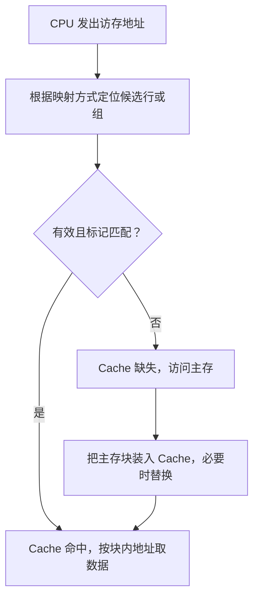

课件来源：《【精讲】萝卜哥自考-计算机系统原理-第5章》，第 7～15 页。

## 5.3.1 Cache 的工作原理

### 1. 基本概念

- Cache 行（槽）：Cache 中存放一个主存块的位置。
- 有效位：表示该行当前是否含有有效数据，**0 表示无效，1 表示有效**。
- 标记：用来识别该行保存的主存块。
- 命中：所需数据已在 Cache 中。
- 缺失：所需数据不在 Cache 中，需要访问下一级存储器。

### 2. CPU 访问 Cache 的过程

### 3. 平均访问时间

设命中率为 h，命中时间为 $T_h$。若 $T_m$ 表示一次缺失访问的**总时间**，则：

$$
T_{\text{avg}}=hT_h+(1-h)T_m
$$

若题目给的是命中查找时间之外的**缺失额外代价** P，则：

$$
T_{\text{avg}}=T_h+(1-h)P
$$

先区分题目所给“缺失时间”的口径，再代入公式。

## 5.3.2 Cache 行与主存块的映射

### 1. 三种映射方式

| 方式 | 主存块可放的位置 | 地址组成 |
|------|------------------|----------|
| 直接映射 | 固定的一行 | 标记、行号、块内地址 |
| 全相联映射 | 任意一行 | 标记、块内地址 |
| 组相联映射 | 固定一组中的任意一行 | 标记、组号、块内地址 |

### 2. 映射规则

设主存块号为 b，Cache 行数为 L、组数为 S：

- 直接映射：行号为 `b mod L`。
- 全相联映射：可放入任意行，需要比较候选行的标记。
- 组相联映射：组号为 `b mod S`，在该组内选择一行。

**先按块大小划分块内地址，再按映射方式划分行号或组号，剩余高位作为标记。**

## 5.3.3 三种映射的特点

### 1. 直接映射
**每个主存块只能放到固定的一行。**

**优点：**

- 硬件简单、成本低。
- 按行号定位后只需比较一个标记，查找速度快。
- 替换位置固定，不需要选择替换行。

**缺点：**

- 放置不灵活，冲突缺失较多。
- 即使其他行空闲，也只能使用固定行。
- 映射到同一行的热点块可能反复互相替换。

### 2. 全相联映射
**每个主存块可以放到任意一行。**

**优点：**

- 放置灵活，Cache 空行可充分利用。
- 没有因固定映射位置造成的冲突缺失。

**缺点：**

- 需要在所有行中查找匹配标记。
- 并行比较时硬件复杂、成本和功耗较高，行数增多时查找开销大。
- Cache 满后需要替换算法选择被替换行。

### 3. 2 路组相联映射
**每个主存块只能放到固定的一组，但可放在该组内任意一行。**

