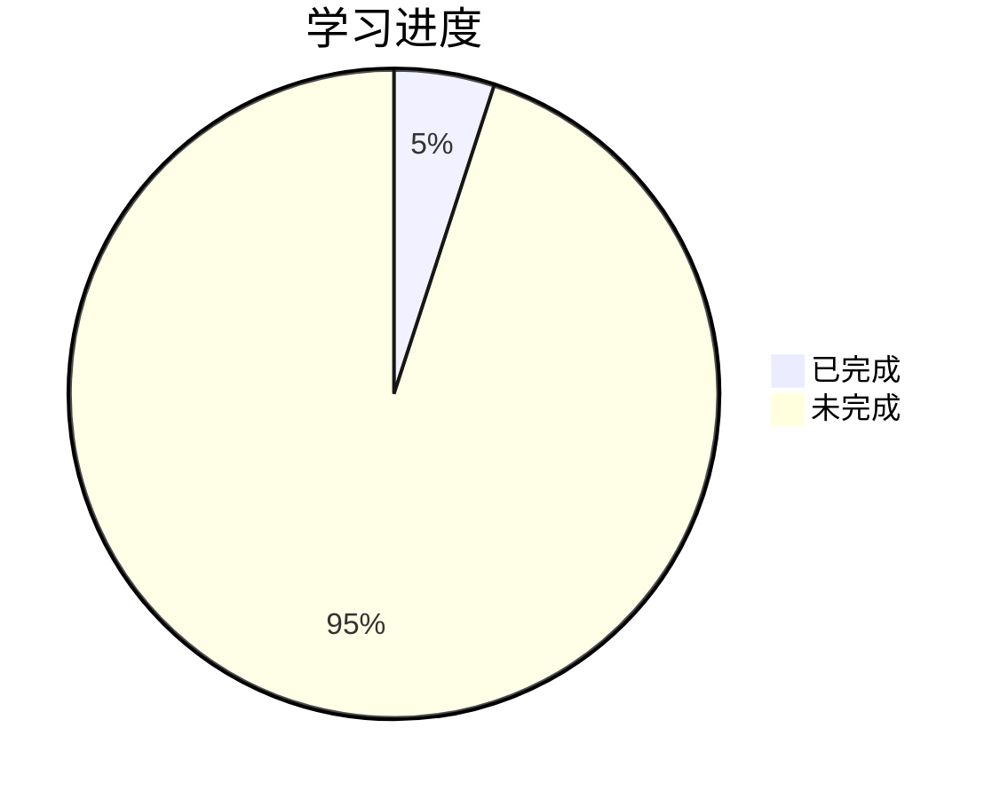

# 学习进度

## 课程信息
- 课程代码: 13015
- 教材: 《计算机系统原理》袁春风
- 目标完成时间: 2026年9月底

## 总体进度

**总体完成度: 5%**

## 章节进度

| 章节 | 内容 | 进度 | 状态 |
|------|------|------|------|
| 01 | 计算机系统概述 | 30% | 🔵 学习中 |
| 02 | 数据表示和运算 | 0% | ⬜ 未开始 |
| 03 | 程序转换与机器级表示 | 0% | ⬜ 未开始 |
| 04 | 可执行文件的生成与加载 | 0% | ⬜ 未开始 |
| 05 | 程序的存储访问 | 0% | ⬜ 未开始 |
| 06 | IO操作的实现 | 0% | ⬜ 未开始 |

### 第一章进度详情

| 小节 | 内容 | 状态 |
|------|------|------|
| 1.1 | 冯诺依曼结构计算机特点 | ✅ 已完成 |
| 1.2 | 程序的开发和执行过程 | ⬜ 未开始 |
| 1.3 | 计算机系统层次结构 | ⬜ 未开始 |
| 1.4 | 计算机性能评价 | ⬜ 未开始 |

### 第二章进度详情

| 小节 | 内容 | 状态 |
|------|------|------|
| 2.1 | 数值数据的表示 | ⬜ 未开始 |
| 2.2 | 非数值数据的表示 | ⬜ 未开始 |
| 2.3 | 数据的存放 | ⬜ 未开始 |
| 2.4 | 数据的运算 | ⬜ 未开始 |

## 练习进度

| 类型 | 内容 | 状态 |
|------|------|------|
| 章节练习 | 各章节课后习题 | ⬜ 未开始 |
| 真题 | 历年真题 | ⬜ 未开始 |
| 模拟题 | 模拟试卷 | ⬜ 未开始 |

## 视频学习记录

| 日期 | 课程 | 进度 | 备注 |
|------|------|------|------|
| 2026-09-14 | 精讲2 | 6:22 | - |

## 版本记录

| 版本 | 日期 | 内容 |
|------|------|------|
| v0.1 | 2026-09-14 | 初始化学习进度页面 |
