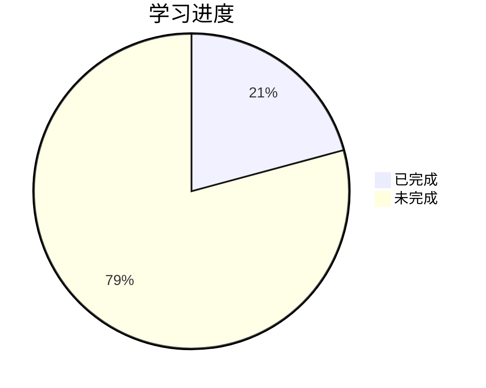

# 学习进度

## 课程信息
- 课程代码: 13015
- 教材: 《计算机系统原理》袁春风
- 目标完成时间: 2026年9月底

## 总体进度

**总体完成度: 约 20.8%**（按六章等权估算，第一章已完成，第二章完成约 25%）

## 章节进度

| 章节 | 内容 | 进度 | 状态 |
|------|------|------|------|
| 01 | 计算机系统概述 | 100% | ✅ 已完成 |
| 02 | 数据表示和运算 | 25% | 📖 学习中（2.1 数值数据的表示已完成，按四节等权估算） |
| 03 | 程序转换与机器级表示 | 0% | ⬜ 未开始 |
| 04 | 可执行文件的生成与加载 | 0% | ⬜ 未开始 |
| 05 | 程序的存储访问 | 0% | ⬜ 未开始 |
| 06 | IO操作的实现 | 0% | ⬜ 未开始 |

## 练习进度

| 类型 | 内容 | 状态 |
|------|------|------|
| 章节练习 | 各章节课后习题 | ⬜ 未开始 |
| 真题 | 历年真题 | ⬜ 未开始 |
| 模拟题 | 模拟试卷 | ⬜ 未开始 |

## 视频学习记录

| 日期 | 课程 | 进度 | 课件进度 | 学习时长 | 备注 |
|------|------|------|----------|----------|------|
| 2026-09-14 | 精讲2 | 6:22 | — | — | 首次学习，未记录时长 |
| 2026-09-28 | 精讲2 | 59:08 | 第一章 16/19 | 0h53m | 6:22 → 59:08 |
| 2026-10-05 | 精讲2 | 1:21:04（已结束） | 第一章结束 | 0h22m | 59:08 → 1:21:04 |
| 2026-10-12 | 精讲03 | 36:05 | 第6页 | 36:05 | 2.1.1 进位计数制 |
| 2026-10-13 | — | — | 2.1 数值数据的表示结束 | — | 完成 2.1.2～2.1.6：定点数编码、浮点数、数据宽度和单位、大端和小端、作业 |

## 版本记录

| 版本 | 日期 | 内容 |
|------|------|------|
| v0.1 | 2026-09-14 | 初始化学习进度页面 |
